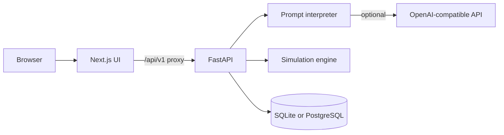

# Architecture

The browser talks only to the Next.js origin. `frontend/app/api/v1/[...path]/route.ts` forwards requests to `API_INTERNAL_URL` at runtime, so the API address is not baked in at build time.

The interpreter returns an `ElectionSpecification`. Validation rejects inconsistent probabilities, populations, and method combinations instead of repairing them. `app/engine/simulate.py` draws binomial turnout and multinomial ballots with NumPy's PCG64 generator. Summaries, comparisons, and sensitivity reports are computed from those draws.

Persistence uses SQLAlchemy models in `backend/app/db/models.py` and Alembic revisions `0001_initial` and `0002_accounts`. Startup runs `upgrade head`. The default URL is `sqlite:///./data/elections.db` relative to the backend working directory. A `postgresql+psycopg://` URL uses PostgreSQL and a connection pool. In accounts mode, projects, simulations, and dataset records carry `owner_id`. Development and private mode only read rows whose owner is null.

Execution is an in-process `ThreadPoolExecutor` with two workers. Cancellation is checked between iterations, and only for a job this process has already accepted. A restart marks queued and running rows failed. This is not a distributed queue, so a second API process would not share the in-memory cancel flags or the worker threads.

Charts on the results and comparison pages read fields from the simulation response. They do not contain a built-in election dataset.
